# #731 — in-cell practice, artwork, Feel and compact availability UI

Organizer follow-up to the merged #727, implemented from main `d25bc324` on
2026-11-02. This batch retires practice stars and refines both private
sheets using MainSheet surfaces, typography and existing locale catalogs.
The next organizer request adds optional Feel alongside score/comment.
The following request adds the corresponding beatmap background.
The 2026-11-03 follow-up moves editing into the record cell and compacts the
identity actions.

## Result

Practice contains score/Feel/comment, with compact pool/Mod tabs, labelled
reload/save/delete icons and an editor directly in the actor's own cell. Each map
uses one table row. Long literal teammate comments show a three-line preview and expand through
an explicit keyboard-accessible disclosure. New edits hide obsolete Saved text.
Current read projections and commands omit rating; legacy rating input is
rejected. The nullable legacy column remains, old reads do not modify it, and
normal owner save/delete clears it while retaining the previous value in the
private transactional audit. Separate nullable Feel storage is added by
`0072_practice_feel.sql`, with a database constraint for `bad`, `normal`, `good`
or NULL. Existing records remain unset. Old stars are never converted to Feel.
An older score/comment payload preserves saved Feel and its retry hash; current
forms explicitly send NULL to clear Feel. Deletion clears it in the same audit.
Score/Feel/save share the first line inside the owner cell, with comment/delete
below. The actor's column is ordered first; horizontal scrolling retains the map
and player headers.

The timetable initially focuses the selected day. Weekday shortcuts and the
Week control switch between that day and the full seven-day overview while
retaining all drafts. The selected day remains visible in the shortcut strip,
and Week stays pinned on narrow screens. Resize/side-panel width changes realign
the saved hour and selected day. Names, date and time headers stay readable;
continuous state bands reduce repeated marks, and UTC offsets appear once per
date except when a repeated hour needs disambiguation. Compact undo/save and the
legend stay beside the grid; optional help supports Escape.

All existing ownership, current-captain team visibility, optimistic versions,
idempotency, chart-context, UTC/DST and unfilled/explicit-state semantics remain.

## Numeric BID capsule — 2026-11-03

The provided reference replaces the BID label with the literal difficulty ID
and copy icon in a purple capsule. Success retains the number and swaps only
the icon for a check. On mobile, direct sits beside the slot and the capsule
below the map metadata; pointer targets remain 44px for touch input.

The full isolated-DB run passed **267 files and 2,317 tests, with two skipped**.
Check, final production build and diff checks passed; audit found 0 vulnerabilities.
All **20 focused Chrome checks passed**, including seven-digit IDs in the
320px/719px compact-row checks and keeping the number visible after copying.
The initial coarse-pointer mobile row measured 160px; tightening only the map
padding/gaps retained the existing 155px ceiling and the final run passed.
Manual light/dark screenshots use synthetic metadata and a seven-digit fixture.
Full application E2E/all-appearance matrices were not run (too slow).

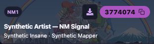
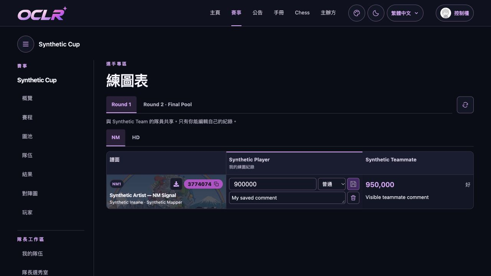
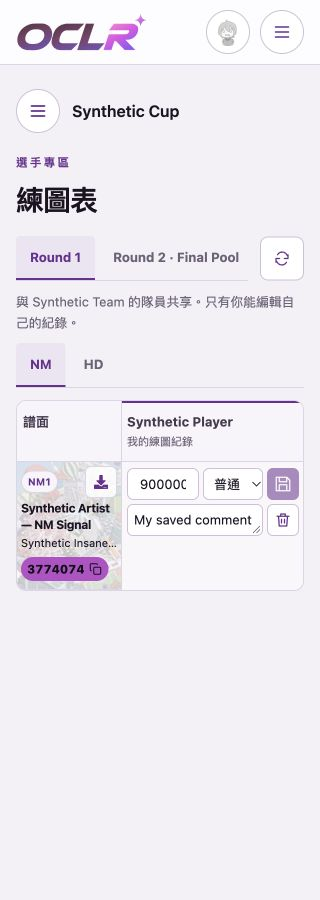

## In-cell follow-up — 2026-11-03

The separate editor row is removed. Only the actor's writable cell displays inputs;
the current score/Feel/comment are not duplicated above it. Saving and deletion
retain the same mounted form and version/retry behavior. An outdated own map
record is available in a Previous map context disclosure beside the fresh form.
Read-only workspaces retain saved-value cells.

The official osu! web action moves to the literal beatmap-title hyperlink.
Direct is a compact icon beside Copy BID, which copies the difficulty ID, reports
success and exposes clipboard failure. The desktop targets are 32px; coarse
pointer targets remain 44px. Map titles use two lines and metadata one preview
line, with literal full text retained. Normal row measurements with the synthetic
fixture and fine pointer: **88.6px at 1280px**, **126.5px at 320px**; alerts,
expanded comments/history and longer FM policy text may increase row height.

Twenty focused Chrome component checks passed across desktop/mobile and
light/dark. They cover single-row owner-cell editing, first-column ordering at
320px/719px, draft retention, linked title/direct destinations, copied BID vs set
ID, clipboard failure, outdated-map history, saving, safe deletion retry and
recreation, and read-only controls. These focused checks address the changed
browser layout/interaction; full application E2E was not run (too slow).

`npm run check`, production build, catalog extraction and audit passed; no new
locale messages, read contracts or schema changes were introduced in this
follow-up. `npm audit --omit=dev` found 0 vulnerabilities.

The full isolated-DB run completed with 2,316 passed, two skipped and one i18n
guard failure: a literal BID label in JSX. The label now uses the existing BID
catalog entry. The affected `test:i18n` suite then passed all four tests, followed
by a fresh successful check/build. The other 2,313 tests had passed in the full
run; the full suite was not repeated for that label-only fix. Focused browser
results remain the 20 passing checks described above, whose visible label stays
BID in all three locales.

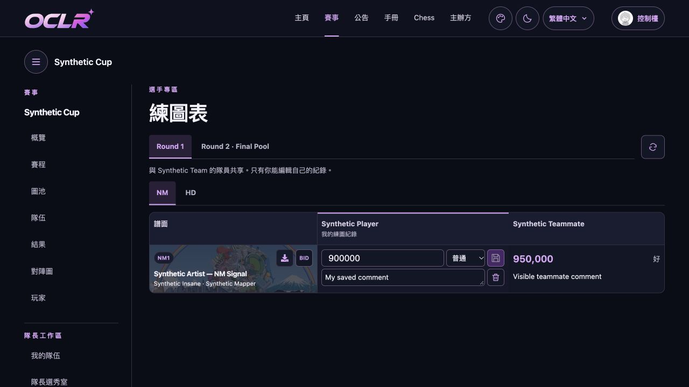
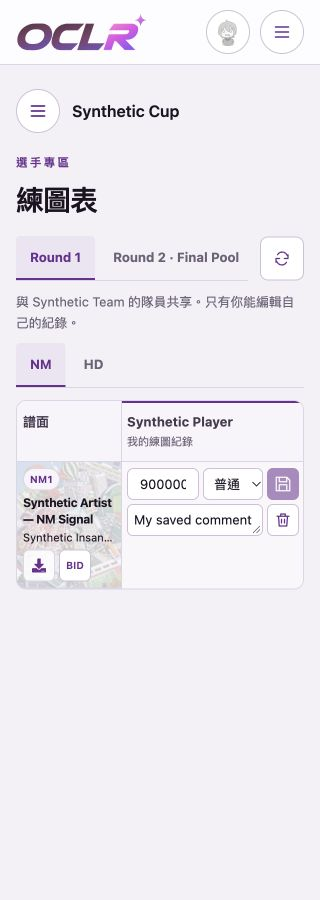

## Artwork follow-up

The fixed map column now reuses BeatmapCover and its official beatmapset cover
URL. A decorative layer at 24% opacity fills the cell without changing its
intrinsic row height. Map metadata uses MainSheet foreground for readable
contrast in both themes. The layer has no pointer targets and is hidden from
screen readers. A missing cover leaves the original surface; shared image
failure handling is retained. No data schema, command or interface text changes.

Manual synthetic browser inspection covers desktop and 320px, light/dark, and
missing-cover fallback. The mobile cover overrides the shared thumbnail height
cap so the background fills the whole identity cell. The fixture's
`?missing-cover` option supplies an invalid set ID for the absent-cover check.
No new browser suite was run; E2E was not run (too slow), following ordinary
development policy.

This follow-up passed `npm run check`, the final production build and the full
isolated-DB suite: **267 files, 2,317 tests passed and two skipped**.
`npm audit --omit=dev` found **0 vulnerabilities**, and `git diff --check` passed.
No new unit tests were added for the decorative layout; existing artwork and
private-workspace tests remain in the complete suite.

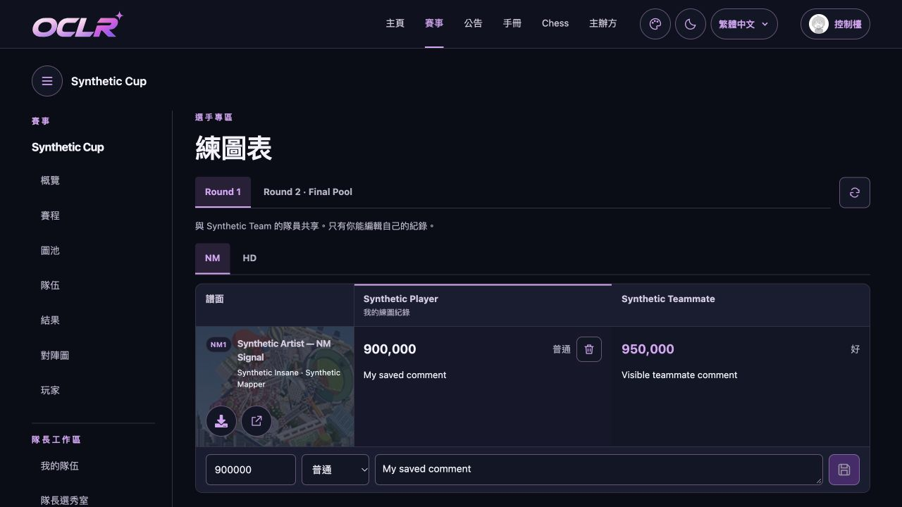
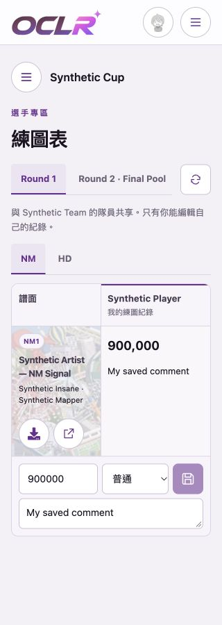

## Feel follow-up verification

- `npm ci --include=dev` on Node 24, using the existing lockfile.
- Migration `0072` applied successfully to the dedicated disposable
  `oclr_osusheets_test` database on loopback port 55482.
- `npm run check` and production `npm run build` passed. Full `npm test` on that isolated database: **267 files
  passed; 2,317 tests passed, two skipped**. New cases cover permitted/invalid
  values, nullable storage, saved team reads, private audit, old-payload
  preservation, retries, explicit clearing and deletion.
- `npm run read-api:generate` produced no delegated-contract changes;
  `npm run read-api:check` passed (57 contracts, 181 inventory rows, eight tests).
- i18n extraction synchronized catalogs; i18n tests passed in the full suite.
- `npm audit --omit=dev`: **0 vulnerabilities**.
- Manual synthetic browser inspection: desktop and 320px, light/dark, native
  Feel selection and dirty/save state. Screenshots below show only synthetic
  identities and inputs. The updated component spec was not run this round;
  E2E was not run (too slow), following the ordinary-development policy.

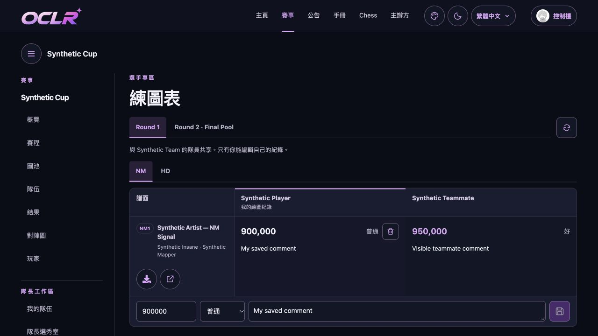
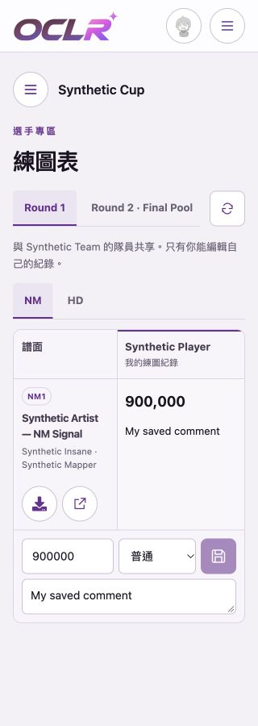

New review text includes 手感 and 差／普通／好, plus the practice introduction and
validation message. CI, organizer wording/layout acceptance and deployment
remain separate from local checks.

## Original UI verification at `8a4b0cc2`

- Node 24.22.2 and the existing npm lockfile/dependency installation.
- `npm test` on the dedicated disposable `oclr_osusheets_test` cluster: **267
  files passed; 2,314 tests passed, two skipped**. Includes the new retirement case
  proving legacy read safety, rejected rating input, owner save and audit history.
- `npm run check` (lint/types) and `npm run build`: both passed for the final
  implementation, including the resize refinement.
- `npm run i18n:extract`: catalogs synchronized and all new translations filled;
  i18n tests passed in the full suite.
- `npm run read-api:check`: **57 contracts, 181 inventory rows and eight tests
  passed**; personal workspace fields remain outside delegated read contracts.
- `npm audit --omit=dev`: **0 vulnerabilities**.
- Focused Chrome component browsers: **36 passed** across desktop/mobile and
  light/dark for both sheets. After the final date-strip/resize refinement, all
  **26 timetable checks passed** again, including 320px, resize, hidden-help
  geometry/Escape, day/week draft retention, touch/mouse painting, backwards
  strokes, undo, midnight, repeated New York hours, read-only boundaries and retry.
  The practice checks cover absence of stars/rating payloads, row alignment,
  full comments, pinned geometry, Mod drafts and delete/retry/recreate.
- `git diff --check`: passed. Images use only synthetic identities and inputs.

The initial disclosure tests used an implicit summary role that the browser test
engine exposed as generic; explicit button roles fixed the cross-engine naming,
and the rerun passed. Full application E2E/all-appearance matrices were not run.
CI and organizer wording/layout acceptance are separate from these local checks.

New Chinese review text: 阅读完整评论／閱讀完整評論, the score/comment-only
practice introduction and validation message. Extraction also registered the
existing missing public-name lookup error, filled in both Chinese catalogs.

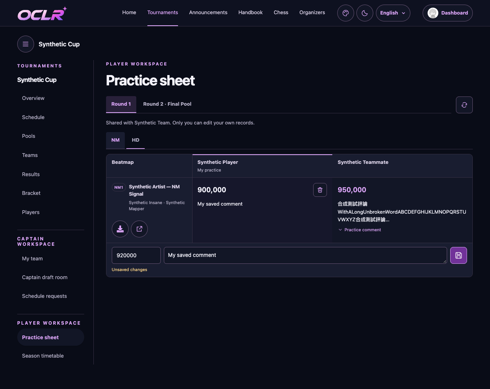
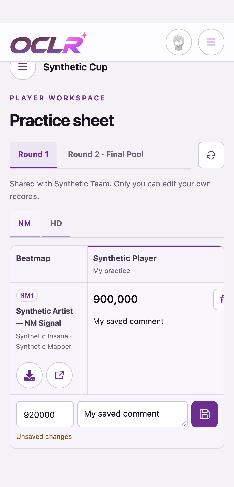
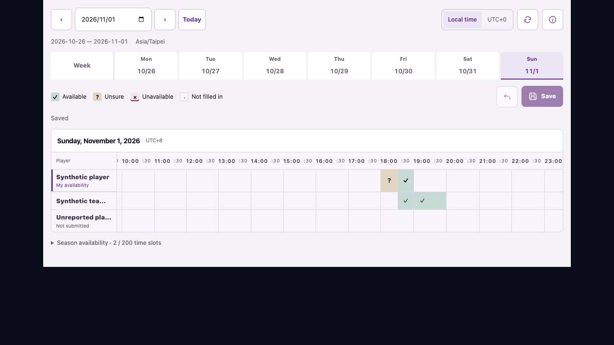
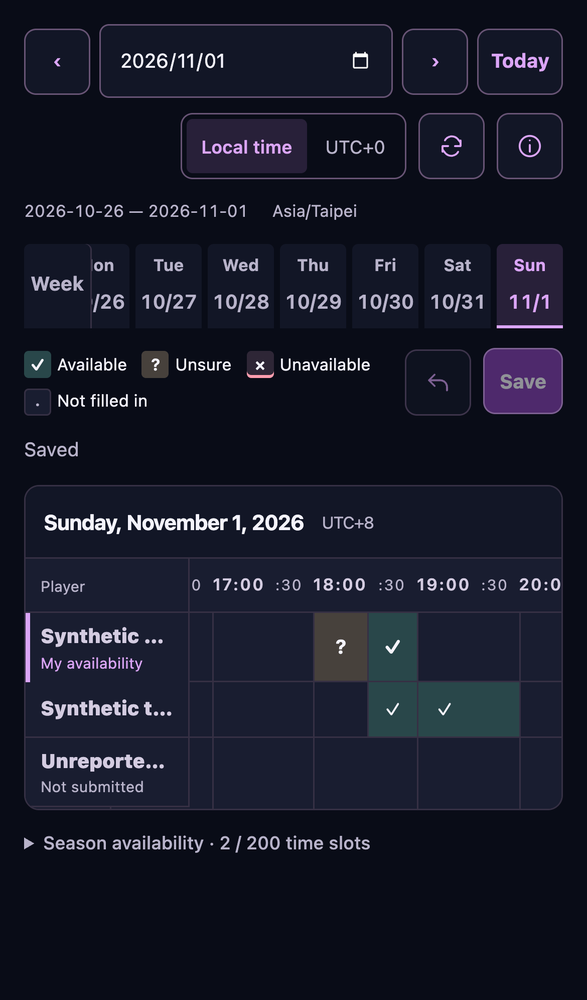
